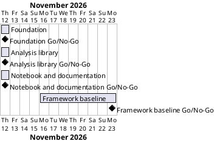

# Project Plan

## Metadata
| Key | Value |
| --- | --- |
| ID | PP-001 |
| CrossReference | [BC-001], [SA-001], [MIL-001], [MIL-002], [MIL-003], [MIL-004] |
| Language | en |
| Domain | education |

## Version History
| Date | Status | Author | Reviewer | Change | Commit |
| --- | --- | --- | --- | --- | --- |
| 2026-11-12 | Deprecated | Jens Tirsvad Nielsen | AI as stand-in for S01 | Repository renamed to 078-Seaborn-and-Linear-Regression: links updated | [0c53f49] |
| 2026-11-12 | Deprecated | Jens Tirsvad Nielsen | AI as stand-in for S01 | Link the synced milestones | [05893f4] |
| 2026-11-16 | Accepted | Jens Tirsvad Nielsen | S01 (AI as stand-in) | Added the baseline gateway MIL-004 with its schedule row, scope coverage, dependency, risk and Gantt entries; recorded the move of the end date, the domain, the open pull request #33, the prompt log and the unchanged wiki in the Planning Assumptions and Open Issues; corrected the open issue about the traceability matrix, which exists as TM-001; set the domain to education; reviewed in autonomous mode, not independent<br>Reviewed in RC-015: Go | pending |

---

## Purpose

This plan schedules three gateways that turn the Day 78 Seaborn and linear regression assignment into a tested repository, a notebook and a three-language wiki, inside the Business Case constraint of completion by 2026-11-12, and, since the baseline gateway [MIL-004], a fourth gateway that brings the finished project to the baseline of the framework without changing the program.

## Planning Assumptions

- The plan starts and ends 2026-11-12, per the Business Case constraint ([BC-001]).
- One branch and one pull request per gateway; each pull request closes its issues.
- Stakeholders are served as [SA-001] sets out: S01 accepts the plan in chat; S02 and S03 are informed through the README and the wiki.
- Baseline: the plan was created fresh; no earlier baseline exists.
- The baseline gateway MIL-004 starts 2026-11-16 and ends 2026-11-23, one week (source: [BC-001], Constraints). It brings the finished project to the baseline of the framework, a decision of S01. MIL-001 to MIL-003 were accepted on 2026-11-12 as planned; their rows keep the planned dates, so the end date of the plan moves from 2026-11-12 to 2026-11-23.
- For MIL-004 S01 has authorised the assistant to commit, push, open the pull request and merge it, and the review is done by an AI stand-in for S01 (source: [BC-001], Constraints and Risks).
- The PO language is English; the domain is IT until [MIL-004] and education since.

## Gateway Schedule

| Gateway | Document | Window | Decision date | Owner | Stories | Main deliverable | Milestone |
| --- | --- | --- | --- | --- | --- | --- | --- |
| Foundation | [MIL-001] | 2026-11-12 | 2026-11-12 | S01 | none (technical tasks) | Project configuration, data, set-up guide, repository description | [MIL-001 milestone](https://git.tirsystem.com/Tirsvad-Udemy-100-days-of-code/078-Seaborn-and-Linear-Regression/milestone/486) |
| Analysis library | [MIL-002] | 2026-11-12 | 2026-11-12 | S01 | none (technical tasks) | Tested `movie_regression` package | [MIL-002 milestone](https://git.tirsystem.com/Tirsvad-Udemy-100-days-of-code/078-Seaborn-and-Linear-Regression/milestone/487) |
| Notebook and documentation | [MIL-003] | 2026-11-12 | 2026-11-12 | S01 | none (technical tasks) | Notebook, screenshots, README and wiki in en, da and ms | [MIL-003 milestone](https://git.tirsystem.com/Tirsvad-Udemy-100-days-of-code/078-Seaborn-and-Linear-Regression/milestone/488) |
| Framework baseline | [MIL-004] | 2026-11-16 to 2026-11-23 | 2026-11-23 | S01 | none (technical tasks) | Branch `mil-004-framework-baseline` merged: the adopted framework release, the README, licence and project URL metadata, `.editorconfig`, `.env.example`, the traceability matrix and review records | [Milestone 599][ms-599] |



## Scope Coverage

| Business Case scope item | Gateway |
| --- | --- |
| Python package under `src/`, tests under `tests/` | [MIL-002] |
| `pyproject.toml`, `.gitignore`, `.venv` guide, dataset | [MIL-001] |
| The nine Day 78 lecture steps as a notebook | [MIL-003] |
| README and wiki | [MIL-003] |
| The baseline: framework release, README, licence and project URL metadata, editor settings, environment template, traceability matrix, review records (objective 7) | [MIL-004] |
| Local opengrep scan before every push | [MIL-001], [MIL-002], [MIL-003] |

## Dependencies

```
MIL-001 → MIL-002 → MIL-003 → MIL-004
```

A No-Go on a gateway holds the later gateways; S01 decides whether the end date 2026-11-12 moves, and records the move in a new Version History row of this plan.

## Plan Risks

| Risk | Impact | Mitigation |
| --- | --- | --- |
| The git host is unreachable or a token lacks a scope | Issues, pull requests or the description cannot be published | The work stays on local branches; the run stops and reports |
| Language criteria 3, 5 and 9 of QC-LANG-001 cannot be closed by a stand-in | A document stays `Go-with-conditions` | S01 confirms them in chat when accepting the plan |
| Screenshots drift from the code | Documentation misleads | One script regenerates every screenshot |
| A continuous integration (CI) check fails on the pull request of MIL-004 | The merge is delayed past 2026-11-23 | The failure is fixed on the same branch and the checks run again; after three failed rounds on one cause the work stops and S01 decides (trace: success criterion 7 of [BC-001]) |

## Open Issues

- No domain dictionary (`DICT`) is written; the PO terms are those of the course and are used consistently. S01 may ask for one later.
- No governance document is planned; the traceability matrix is TM-001.
- Domain: since [MIL-004] the plan, the Business Case and the baseline milestone have the domain `education`. The other documents (Stakeholder Analysis, milestones MIL-001 to MIL-003 and the review records RC-001 to RC-013) keep the domain `it` they were accepted with; they are not changed by the baseline, and a change of their domain would need a new review of each. The project has no Domain Dictionary.
- The git host also has the open pull request #33 (framework submodule URL in lowercase); the baseline delivers the same change in the pull request of MIL-004, and S01 decides about #33 after the merge. The baseline does not close it.
- The prompt log `docs/ai-prompts/` is listed in `.gitignore` and not tracked (the repository is public); MIL-004 keeps its prompt log in the new session folder `session-002` there.
- The wiki (11 English pages with a Danish and a Malay page each, and the sidebar) already followed the wiki checklist and was the same on the host as in `docs/wiki/`; MIL-004 changes no wiki file.

---

[BC-001]: ./business-case.md
[SA-001]: ./stakeholder-analysis.md
[MIL-001]: ./milestones/mil-001-foundation.md
[MIL-002]: ./milestones/mil-002-analysis-library.md
[MIL-003]: ./milestones/mil-003-notebook-and-docs.md
[75358c9]: https://git.tirsystem.com/Tirsvad-Udemy-100-days-of-code/078-Seaborn-and-Linear-Regression/commit/75358c998f55477ee25c074190b930f013dacf95
[05893f4]: https://git.tirsystem.com/Tirsvad-Udemy-100-days-of-code/078-Seaborn-and-Linear-Regression/commit/05893f41aae21135dc35b92b751f812348264c7a
[0c53f49]: https://git.tirsystem.com/Tirsvad-Udemy-100-days-of-code/078-Seaborn-and-Linear-Regression/commit/0c53f4937356313c050ca363dd93dd52aa3a4cc3
[MIL-004]: ./milestones/mil-004-framework-baseline.md
[ms-599]: https://git.tirsystem.com/Tirsvad-Udemy-100-days-of-code/078-seaborn-and-linear-regression/milestone/599
